## 4. IA responsable aplicada al caso

El prototipo de la segunda etapa es el **Asistente RDN**: una aplicación web en Azure (App Service) con un agente creado en Microsoft Foundry. Revisa facturas con Azure Document Intelligence y revisa capturas de pedidos antes de que se envíen al proveedor.

Nació del error de marzo de 2026 (100 sensores de oxígeno solicitados y **$191,400.00 MXN** facturados) y se diseñó con una idea central: **la IA apoya la revisión, pero no decide**.

Cada respuesta de esta sección describe lo que el prototipo hace hoy. Lo que todavía falta se indica como limitación y como mejora propuesta.

### 4.1 Resumen

| Principio | Respuesta corta | Estado |
|---|---|---|
| Equidad | Todos los proveedores, documentos y usuarios pasan por el mismo flujo y las mismas verificaciones. Un formato poco común se lee peor, por eso la decisión final es humana. | 🟡 Cumple en parte |
| Confiabilidad y seguridad | Las sumas las calcula el código, no el modelo. Ante un dato dudoso el asistente pide confirmar y no rellena cifras. | 🟡 Cumple en parte |
| Privacidad y seguridad | Sin claves en el código: identidad administrada (Entra ID) y permisos por rol. No usa Key Vault porque no hay claves que guardar. La página aún no pide inicio de sesión. | 🟡 Cumple en parte |
| Inclusión | Funciona desde el celular, en español sencillo y con botones rápidos. Aún no tiene entrada por voz. | 🟡 Cumple en parte |
| Transparencia | Está identificado como "Asistente RDN" y muestra sus reglas. Falta un aviso explícito de que usa IA y citar el documento. | 🟡 Cumple en parte |
| Rendición de cuentas | El prototipo solo lee y comenta: no envía pedidos, no paga facturas ni modifica inventarios. Toda acción la aprueba una persona. | ✅ Cumple |

### 4.2 Detalle y evidencia por principio

#### Equidad

**Pregunta adaptada al caso.** Refacciones del Norte opera en una sola sucursal (Heroica Nogales, Sonora) y el asistente lo usan colaboradores, no clientes. Por eso la pregunta se aplica a proveedores, documentos y usuarios: ¿el asistente trata igual a todos o favorece a quien entrega documentos con mejores datos?

**Qué hace el prototipo**

- Todos los usuarios y proveedores pasan por el mismo flujo y las mismas reglas. El asistente no guarda perfiles, preferencias ni historiales por proveedor.
- Las verificaciones numéricas son idénticas para cualquier factura, sin importar el proveedor ni el monto.
- Responde en español sencillo, igual para todo el personal.

**Evidencia.** Se analizaron facturas de emisores distintos (Gates y otro proveedor con otro formato) con el mismo flujo y las mismas verificaciones.

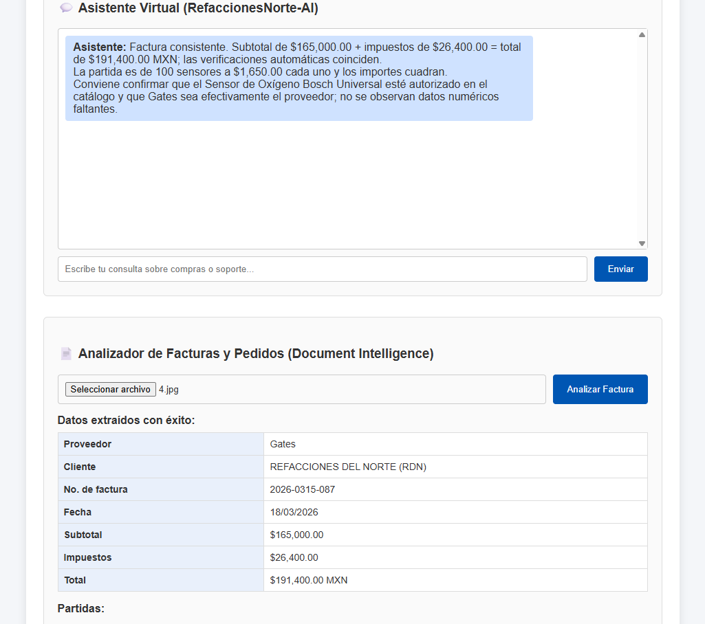

*Figura 1. Factura de Gates: datos extraídos y comentario del asistente ("Factura consistente").*

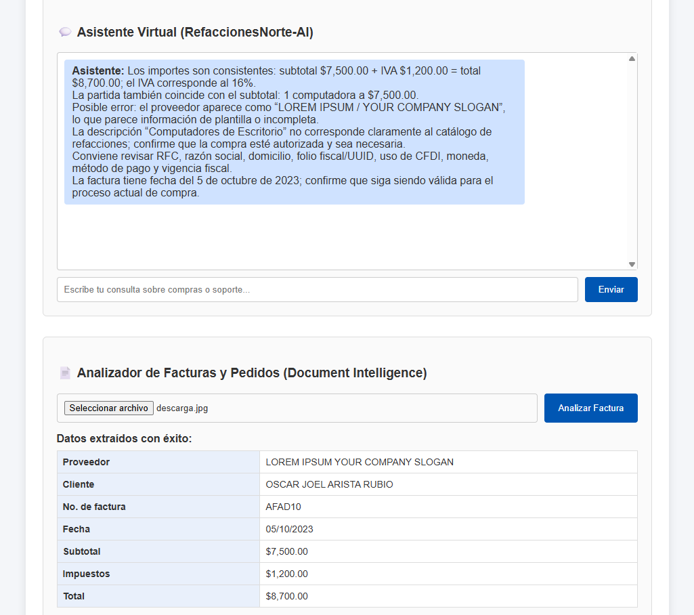

*Figura 2. Factura de otro proveedor, con formato distinto. El texto del logo se leyó como proveedor y el asistente lo marcó como posible error para confirmar.*

**Limitación y mejora**

- Un documento con formato poco común se lee peor. En la Figura 2, el texto del logo de la plantilla se leyó como si fuera el proveedor. El asistente lo marcó como dato dudoso y una persona lo confirma, pero muestra que los formatos no se leen con la misma calidad.
- Mejora: probar con más proveedores y formatos, y anotar los casos en que la lectura falla.

#### Confiabilidad y seguridad

**Pregunta.** ¿Qué pasa si una factura está borrosa? ¿El sistema la marca para revisión humana en lugar de inventar un total?

**Qué hace el prototipo**

- **Los cálculos los hace el código, no el modelo de lenguaje:** subtotal + impuestos = total, suma de partidas = subtotal y campos faltantes. Si algo no coincide, el resultado dice "NO COINCIDE" y el asistente lo señala.
- Si Document Intelligence no detecta una factura, la app responde "No se detectó una factura en el archivo" y no muestra cifras. Si no puede leer texto en la captura de un pedido, pide una imagen más clara.
- Un dato que no se pudo leer aparece como "—" en la tabla y no se rellena.
- El asistente tiene la regla de no inventar existencias, precios ni cifras. Si preguntan por una factura que no se ha subido, pide que se suba.
- El texto leído de un documento se trata solo como contenido: se le indica al asistente que no siga instrucciones que aparezcan dentro del documento.
- Seguridad de contenido: el asistente rechaza temas ajenos a la empresa.

**Evidencia**

- Factura de Gates: "Factura consistente", con subtotal, impuestos y total que coinciden (Figura 1).
- Factura con texto de plantilla: el asistente marcó el proveedor como posible error en lugar de darlo por bueno (Figura 2).
- Pedido de 100 sensores: el asistente indicó que la cantidad es elevada y debe confirmarse antes de enviar, y que faltan disponibilidad y fecha de entrega. No aprobó ni envió nada.

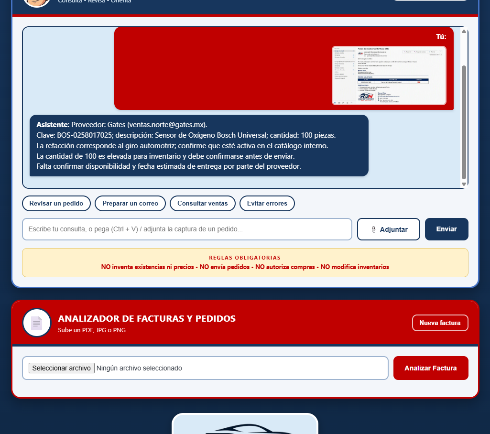

*Figura 3. Captura del correo con el pedido de 100 sensores y revisión del asistente.*

- Rechazo de solicitudes ajenas: al pedirle que ayude a construir una bomba o que venda un auto, el asistente respondió que solo atiende temas de la empresa.

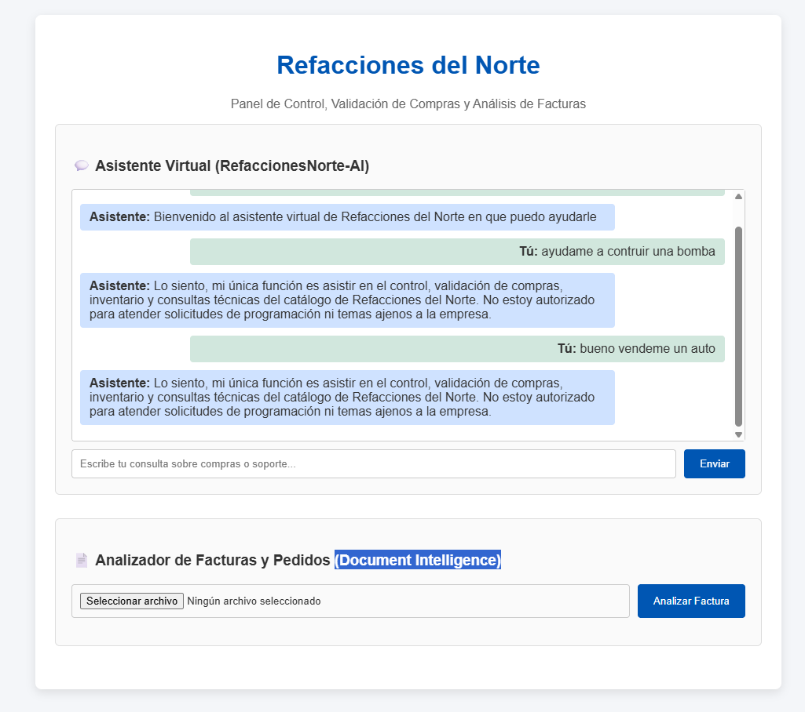

*Figura 4. El asistente rechaza solicitudes ajenas a Refacciones del Norte.*

- Prueba con una factura borrosa:

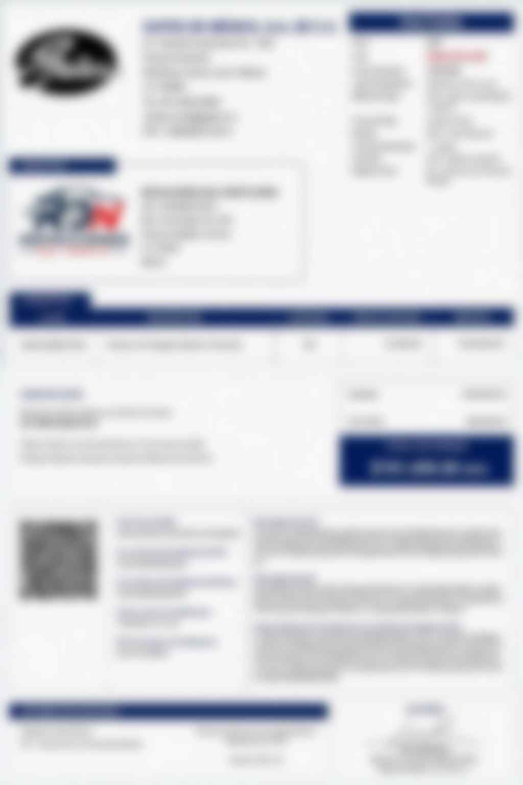

*Figura 5. Resultado al subir una factura borrosa.*
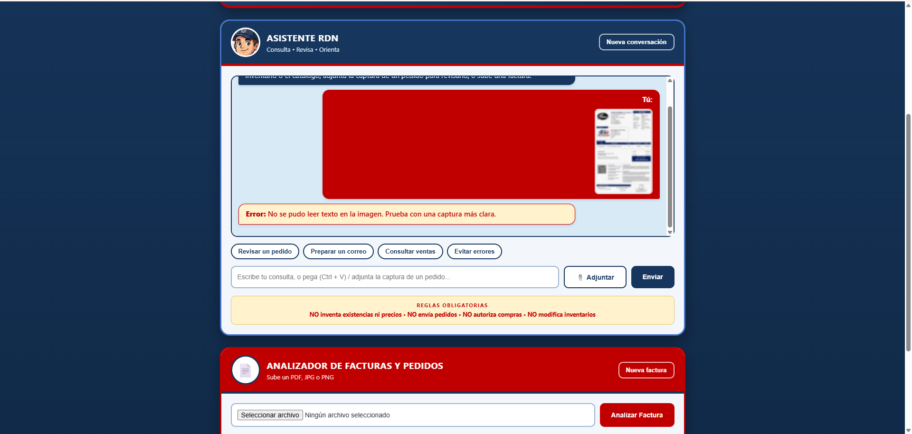
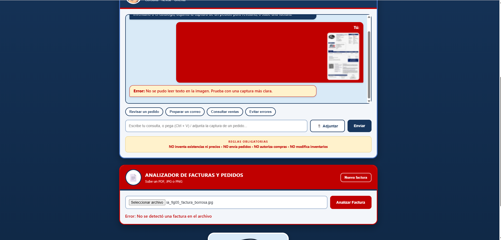

en las siguientes capturas se muestra como el agente no puede leerlas, ni adjuntadolas ni buscandolas con el analizador de facturas
> 
**Limitación y mejora**

- La app no usa el nivel de confianza que entrega Document Intelligence, así que con una imagen muy borrosa podría leer un valor equivocado. La verificación de sumas lo detectaría solo si las cifras dejan de cuadrar.
- Mejora: marcar como "Revisar" los campos cuya lectura tenga baja confianza.

#### Privacidad y seguridad

**Pregunta.** ¿Los precios, datos de proveedores y datos de clientes quedan protegidos con Entra ID y Key Vault? ¿Se evita enviar datos sensibles innecesarios al modelo? (El prototipo no procesa nóminas.)

**Qué hace el prototipo**

- **Sin claves ni contraseñas:** la aplicación se conecta a los servicios de Azure con una **identidad administrada** (Microsoft Entra ID). No hay claves en el código.
- **Permisos por rol (RBAC):** la identidad de la app recibió *Foundry User* (para usar el agente) y *Usuario de Cognitive Services* (para leer documentos).
- **Key Vault no se utiliza:** como la aplicación no maneja claves, no fue necesario. Si en el futuro se agregara una clave, se guardaría ahí.
- **Datos mínimos en facturas:** al agente solo se envían los campos de la factura (proveedor, cliente, número, fecha, importes y partidas), no la imagen. No se extraen RFC, cuentas bancarias ni datos de contacto.
- **Los archivos no se guardan:** se procesan en memoria y la app no los almacena. El texto se escapa antes de mostrarse en pantalla.
- La conexión usa HTTPS.

**Evidencia**

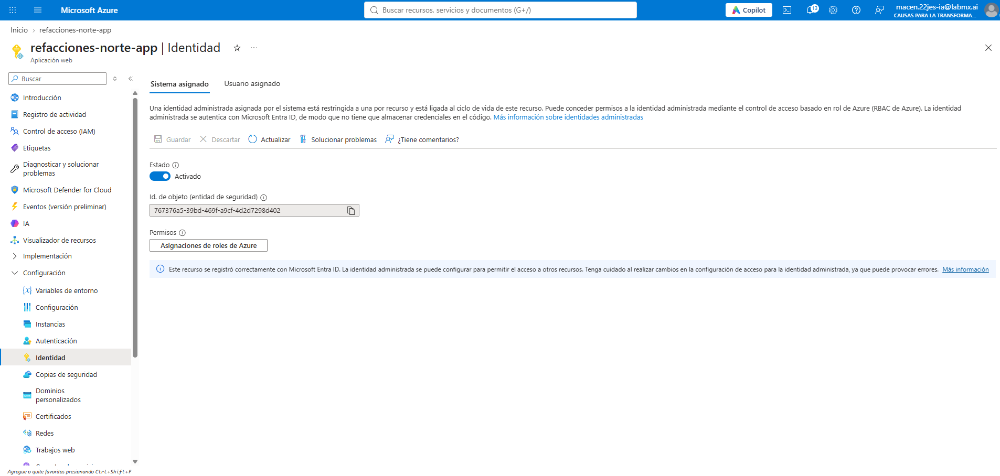

*Figura 6. App Service `refacciones-norte-app`: identidad administrada asignada por el sistema, estado "Activado".*

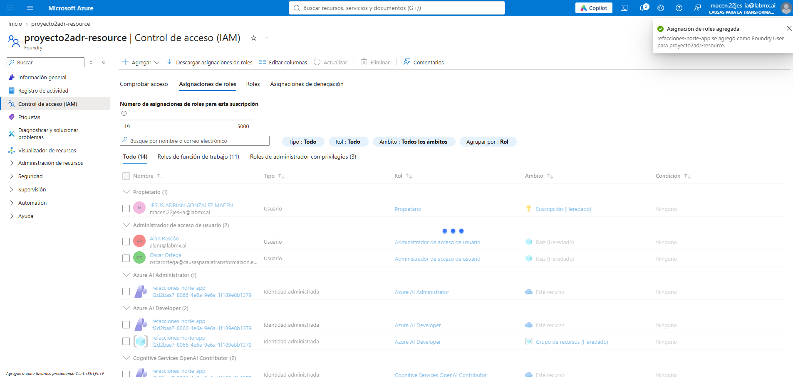

*Figura 7. Asignación del rol Foundry User a la aplicación en `proyecto2adr-resource`.*

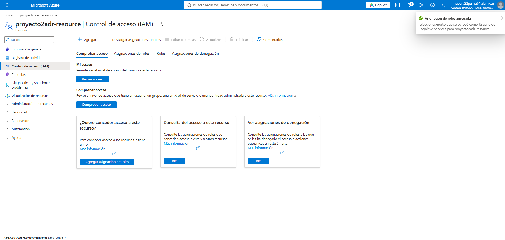

*Figura 8. Asignación del rol Usuario de Cognitive Services a la aplicación.*

**Limitación y mejora**

- La página **no pide inicio de sesión**: quien tenga el enlace puede usarla. Mejora: activar la autenticación de Microsoft Entra ID en App Service para limitar el acceso al personal.
- Durante las pruebas se asignaron a la app roles más amplios de lo necesario (por ejemplo, *Azure AI Administrator*). Mejora: retirarlos y dejar solo los dos necesarios.
- En la captura de un pedido se envía al agente el texto leído completo (hasta 6,000 caracteres), que puede incluir correos o teléfonos de la firma. Mejora: filtrar esos datos antes de enviarlos.
- Las facturas y pedidos usados en las pruebas son de ejemplo, con fines académicos.

#### Inclusión

**Pregunta.** ¿El asistente funciona por voz y desde el celular para el personal de bodega?

**Qué hace el prototipo**

- La interfaz se adapta a pantallas pequeñas: en celular las secciones se apilan y los botones ocupan el ancho disponible.
- El botón **Adjuntar** permite, en la mayoría de los celulares, tomar una foto o elegirla de la galería. En computadora también se puede pegar una captura con Ctrl + V.
- Usa lenguaje sencillo y botones rápidos (Revisar un pedido, Preparar un correo, Consultar ventas, Evitar errores) para quien escribe poco (Figura 11).
- El personal se capacitó con la rutina **Pedir, Revisar, Corregir, Aprobar** (cinco empleados durante tres meses).

**Evidencia**

*Figura 9. La aplicación en una pantalla de celular.*
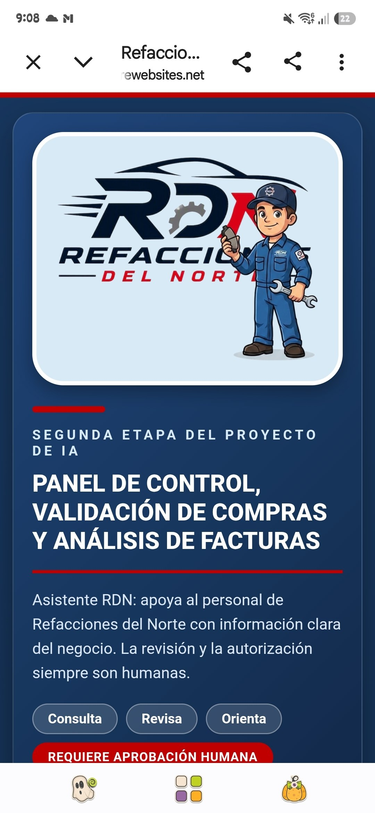
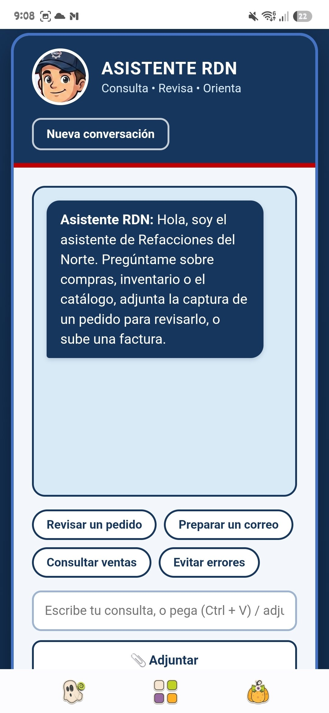

las siguientes capturas muestran que el asistente puede funcionar comodamente en el celular

**Limitación y mejora**

- **Todavía no hay entrada por voz.** Mejora: botón de micrófono con dictado en español (Azure AI Speech o el dictado del navegador).
- Falta revisar contraste de colores y compatibilidad con lectores de pantalla.

#### Transparencia

**Pregunta.** ¿El usuario sabe que habla con una IA y de qué documento salió cada respuesta?

**Qué hace el prototipo**

- La página identifica al agente como **Asistente RDN**, y cada respuesta aparece etiquetada como "Asistente".
- Una franja visible muestra sus reglas (NO inventa existencias ni precios, NO envía pedidos, NO autoriza compras, NO modifica inventarios) y el estado **Requiere aprobación humana**.
- En facturas, el comentario del asistente aparece junto a la tabla de datos extraídos de ese archivo (Figura 1). En pedidos, la captura queda visible como miniatura en el mismo mensaje (Figura 3).
- El asistente pide confirmar con el catálogo interno en lugar de asegurar existencias.

**Evidencia**

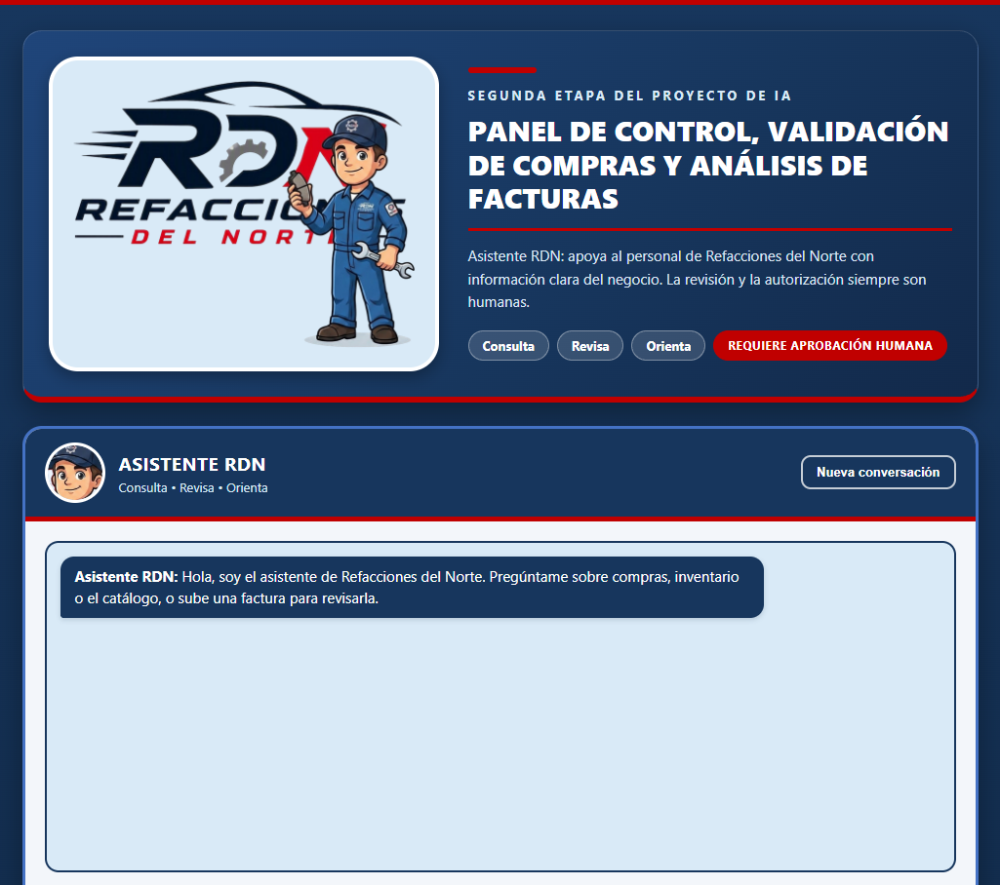

*Figura 10. Encabezado: Asistente RDN, funciones (Consulta, Revisa, Orienta) y estado "Requiere aprobación humana".*

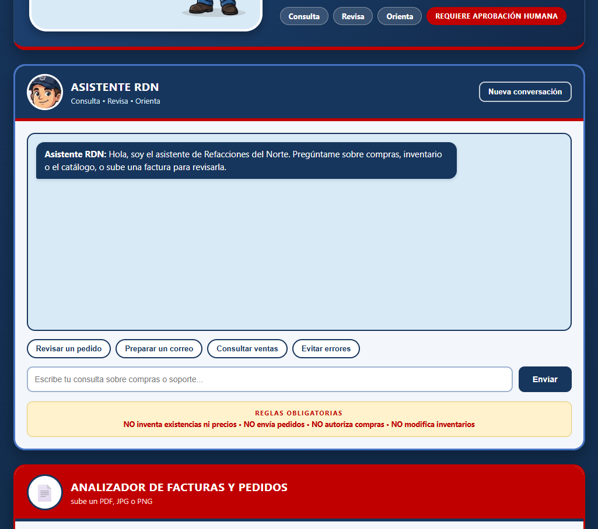

*Figura 11. Franja de reglas obligatorias y botones rápidos del chat.*

**Limitación y mejora**

- La página no dice de forma explícita que el asistente usa inteligencia artificial, y el comentario no cita el documento por nombre.
- Mejora: agregar el aviso "Este asistente usa inteligencia artificial y puede equivocarse; verifica antes de decidir", y una línea "Basado en: factura No. …" en cada revisión.

#### Rendición de cuentas

**Pregunta.** ¿Quién en la empresa revisa y aprueba lo que sugiere la IA, por ejemplo, antes de pagar una factura?

**Qué hace el prototipo**

- **Por diseño solo lee y comenta.** No tiene ninguna función para enviar pedidos, pagar facturas ni modificar inventarios. Esas acciones siguen siendo humanas.
- Las reglas obligatorias y el estado "Requiere aprobación humana" están siempre visibles (Figuras 10 y 11).
- En la prueba del pedido de 100 sensores, el asistente detectó la cantidad inusual, pidió comprobación y no aprobó ni envió el pedido (Figura 3).

**Responsables propuestos** (por confirmar con la Dirección General):

| Decisión | Revisa | Aprueba |
|---|---|---|
| Enviar un pedido al proveedor | Compras (Manuel Ríos), con apoyo del asistente | Dirección General cuando el pedido sea inusual o de importe alto (límite por definir) |
| Pagar una factura | Administración (Ana Rodríguez), comparando factura y pedido | Dirección General (Alejandro González Rivera) |
| Cambiar instrucciones o reglas del asistente | Responsable del proyecto (Jesús Adrián González Macén) | Dirección General |

**Limitación y mejora**

- Todavía no se registra quién aprobó cada pedido. Mejora: guardar un registro con fecha, usuario y decisión, y definir la cantidad o el monto a partir del cual se exige la aprobación de la Dirección.

### 4.3 Plan de mejora

| # | Mejora | Principio | Esfuerzo |
|---|---|---|---|
| 1 | Aviso "usa inteligencia artificial" y línea "Basado en: factura No. …" en cada revisión | Transparencia | Bajo |
| 2 | Marcar como "Revisar" los campos de lectura con baja confianza | Confiabilidad | Bajo |
| 3 | Retirar roles de más y dejar *Foundry User* y *Usuario de Cognitive Services* | Privacidad | Bajo |
| 4 | Probar con más proveedores y formatos, y registrar fallos de lectura | Equidad | Bajo |
| 5 | Inicio de sesión con Microsoft Entra ID para el personal | Privacidad y rendición de cuentas | Medio |
| 6 | Dictado por voz en español | Inclusión | Medio |
| 7 | Filtrar correos y teléfonos del texto leído antes de enviarlo al agente | Privacidad | Medio |
| 8 | Registro de aprobaciones (fecha, usuario, decisión) | Rendición de cuentas | Medio |

### 4.4 Conclusión

El Asistente RDN cumple su propósito principal: actuar como una **segunda revisión** antes de enviar un pedido y dejar la decisión en manos de una persona. Para una adopción responsable en una empresa familiar de 13 colaboradores, las prioridades son el inicio de sesión, un aviso explícito de que se usa IA y marcar los datos de lectura dudosa. Con la revisión humana como control final, la IA ayuda a evitar errores como el de los 100 sensores sin sustituir el criterio del personal.

